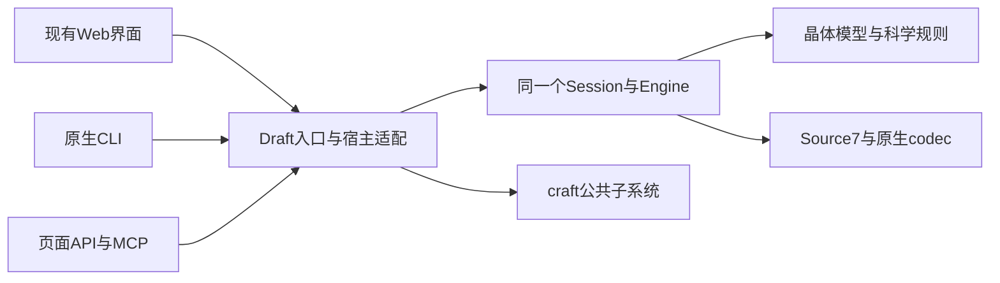

# P2-03公共框架接入整改最终方案（供dsh复审）

日期：2026-11-21。**“最终”指本次方案整理交付；尚未独立接受，尚未施工。** 用户已确认沿用ArtCraft公共框架的做法，并要求先交复审材料、原预算与停报保持。本方案不发放依赖获取、新锁、构建、测试或后续卡权限。

## 给你看的

Draft按七款应用共同采用的方式组织：**公共库承担可复用子系统，应用保留晶体业务适配，界面、CLI和Agent入口操作同一个Engine。** 不再以继续自建通用框架为默认，也不让Draft依赖另一个应用的业务代码。

本次取舍已经收敛：

| 事项 | 最终方案 |
|---|---|
| 公共底座 | 采用统一`craft`门面、固定同一版本、按消费者选择features；门面外必要公共库同版本。优先接完整可用子系统 |
| 业务边界 | 晶体模型、科学规则、Source7身份和资源、事务历史与可信保存语义由Draft负责；公共接口通过适配承接 |
| 当前与后续 | P2-03候选施工处理原生消费者与原卡遗留；公共宿主、配置、控制和界面能力按后续实际消费者接入，不把整个产品都扩入本卡 |
| 界面路线 | 本方案继续采用现有Rust/WASM单Worker＋React/Three.js。公共egui壳需另办路线变更，不把它当成本卡隐藏前提；公共UI/行为能力继续列为目标复用项 |
| 同步与编码 | 本次暂缓atomic同步回退，保留现有同步语义；Base64以统一维护为理由接公共实现，旧实现已只读封存，未来用真实Rust差分核验 |

七款的具体接法和版本并不完全相同：WordCraft/PhotoCraft使用统一门面，另外几款直接接公共crate，SolidCraft维护自己的共享层。我们沿用其共同组织方式，采用适合Draft的明确接法；本次没有证明这些应用的全部功能或平台资格。

P2-03仍partial/未接受。当前累计**138.027328167/14400秒、测试14/14、保守冷构建3/3、0新获取**，停报保持。两条CLI驱动及未到达的迁移/生命周期验证继续保留，方案通过也不等于这些产品结果已经通过。

本次交付包括本方案、七应用对照、旧F1–F5逐项处置、原43候选去向、只读证据与可原文转交的dsh复审说明。只由用户手动发起dsh。

## 给执行者看的

### 1. 权威、基线和接受边界

用户本次指令：“那就按这七款的共同做法整理最终接入整改方案，给我可直接转交dsh的复审材料，先不施工，原预算和停报状态保持不变。”原话及解释见[本轮授权记录](/Users/agilecho/code/VestaDraft/output/vesta-p2-03/20261121-craft-framework-final-plan/authorization.json)。

权威顺序：用户现行决定→现行PRD→技术方案→VESTA需求与已接受设计→本卡。依据为[现行PRD](/Users/agilecho/code/DraftDuet/docs/PRD.md) SW-4/5/7、[技术方案](/Users/agilecho/code/DraftDuet/docs/技术方案.md) C4/C16、§9.6、[P1设计](/Users/agilecho/code/VestaDraft/docs/superpowers/specs/2026-11-10-vesta-p1-design.md)与[接口](/Users/agilecho/code/VestaDraft/docs/superpowers/specs/2026-11-10-vesta-interfaces.md)、[共同约定](/Users/agilecho/code/VestaDraft/docs/任务卡/后续施工共同约定.md)。实际PRD路径与原BranchDraft引用的差异已在前轮盘点核实，本轮不创建旧路径别名。实际输入SHA见本RUN before.json。

[原卡](/Users/agilecho/code/VestaDraft/docs/任务卡/阶段2-首条完整链/03-晶体命令内核与原生保存基础.md) SHA保持`13437984e00cef259ebfb4e7d852d54f9b8251adaf6b72bd41f7749b476f0f57`；U01/U02/U14、T66、NS2、FC、HS4及九profile义务不缩窄。源码现于同仓库app/，原生准入按已获准[续办](/Users/agilecho/code/VestaDraft/docs/任务卡/阶段2-首条完整链/P2-03-原生实现续办.md)继承，不按原卡旧路径反推无权存源码；当前停报仍优先。

| 状态 | 准确登记 |
|---|---|
| Draft实际基线 | `/Users/agilecho/code/VestaDraft`；HEAD `1fe1f0d16bc048b587a5f7fe83243821c38f6d50`、分支codex/p2-03-native、205个app文件与继承WIP/暂存内容；未接craft-libs |
| 已独审结果 | 单相P1有限原生首链获dsh复核；不等于全Source7、全字段/命令、宿主Saved或整卡通过 |
| 最新产品交回 | [14组整改回执](/Users/agilecho/code/VestaDraft/output/vesta-p2-03/20261121-review-corrections/RECEIPT.md)：26项Rust、16编译门禁、14项NS2自验通过；生成访问器/fresh逻辑资源为当前源码自验事实，完整CLI矩阵和四旧件迁移尚未完成 |
| 旧方案复审 | [dsh原报告](/Users/agilecho/code/VestaDraft/output/vesta-dsh-reviews/20261121-105114-p2-03-craft-libs-plan-review/REVIEW.md)为有条件通过、需修订，方案未接受、未授权施工；F1–F5按§5处置 |
| 保留的历史方案 | 原ec30…方案与后继b482…公共框架优先方案保留原字节，本方案作为最新待审入口；旧封存不覆盖 |

前卡正式CA创建和已审安装仍归P2-02，未借本方案完成；不启动P2-04、阶段收尾或宿主Saved验收。

### 2. 七应用共同做法及来源

| 应用 | 固定HEAD | 可核实的复用边界 |
|---|---|---|
| WordCraft | `685869239f31c890c6365f264c14b29ef48fcb7f` | craft门面/公共Host与UI；MCP server接应用Tools和Backend |
| PhotoCraft | `877d58844029967b80e36a964902d309de1be158` | craft门面＋独立格式库；UI和Engine偏好有实际公共消费者 |
| PdfCraft | `4f23ee1c1c2afc6611ca3a71b38162f6259629fb` | PDF对象层直接再导出公共实现；编辑政策和应用MCP适配留应用 |
| VectorCraft | `063f55080244009e0e4bf28c24068479089481ac` | 公共格式读写与页面API；Document、迁移和输出政策留应用 |
| EffectCraft | `86a4828cb6e98495366307dcea323ae21ee55a15` | 公共docking/layout事务与ecproj格式；面板/Project语义由应用适配 |
| CADCraft | `ef6df4dffa7823a620260e16f609403f77ebed55` | 公共DXF标签/DWG桥；Drawing映射、会话和命令留应用 |
| SolidCraft | `82f65a2158b118c9afcee1f7a36514137e1bfc10` | workspace共享视口/UI/MCP层，与业务和GPU/UI胶水分层；不是craft-libs接入证明 |

共同组织原则是：可复用能力在共享层；应用按领域映射；Engine是状态修改入口；UI/CLI/Agent共享命令；核心不依赖UI/OS胶水；版本、输入边界、错误和恢复可追溯。这是方案依据，不是七款全功能命令覆盖的本轮独立验收。

逐项源码入口与差异见[七应用对照](/Users/agilecho/code/VestaDraft/output/vesta-p2-03/20261121-artcraft-foundation-direction/CRAFT-COMPARISON.md)。前轮只读根扫描38仓库，其中21根明确声明craft-libs、2根声明craft门面；不覆盖嵌套/解析后图。六新增应用239份固定blob，WordCraft/公共库53份另存；本轮复算其307成员封存，不重抓上游或运行上游测试。

候选公共版本固定为WordCraft实际pin的`243d68e12d05e89122db6d154924bf1992e10d38`。其229顶层member manifest、236递归manifest与旧checkout `c6c90e991b776a7d2a4231e14220b91c804d650f`的199/206、122旧pin分开登记。PhotoCraft pin另一个e7e877ac…，其他数款也有多rev；不混为同一个已验API版本。新提交只从已有Git对象取得，未fetch/checkout。

### 3. 最终架构、直接集成/适配/自研

下图箭头表示调用/依赖方向；公共库不反向依赖Draft：

图为目标组织，不宣称所有消费者已实现或同一进程跨端共享实例；native/Web分别实例化同源Engine，一个会话内只有该Engine修改内容。

| 能力 | 接法与确定选择 | 进入结果/边界 |
|---|---|---|
| 公共依赖组织 | 直接集成统一craft门面、完整rev；独立公共crate同rev | 拟在app/kernel/Cargo.toml声明workspace依赖，具体消费者选择features；不复制算法或依赖wordcraft-engine等应用业务crate |
| 原生帧与Base64 | 直接调用jsonrpc reader、mime STANDARD；Draft保留配额/错误包装 | 本卡原生消费者，严格按§4；普通JSON-RPC信封/parse_json不接管NS2 |
| Host/配置/快捷键/平台 | 完整公共服务优先＋Draft业务绑定 | 对应宿主/UI消费者；不空建Host或加未使用依赖冒充完成。Host Files/Jobs/SectionStore显式注入；默认普通文件读写/ThreadJobs不能获得Draft根权限或突破单Worker |
| 控制/页面/MCP | 公共automation/control/web-api/mcp-server＋Engine入口适配 | 对应实际控制消费者；请求、取消、权限、错误进入同Engine。公共通道ID/状态机不替代NS2 document/epoch/重放 |
| 页面保存桥 | 公共web-host传输＋HS4适配 | 对应宿主结果；普通saved(id)、无id已发出、上传成功均不自动清dirty |
| 通用行为/界面 | 公共behavior及UI壳/组件为目标复用来源 | 当前保留React/Three.js；纯行为模块需实际WASM/绑定适配；egui组件不当作React组件，迁移另作路线差异审查 |
| 原生文件发布 | 保留Draft当前publish与sync_all；atomic列暂缓 | 本次不启用atomic feature或回退；不改授权根、symlink、baseline、资源先行、主文件最后rename及错误语义 |
| 文件容器/公共格式 | 按实际输入格式接公共实现，领域codec适配 | 不把公共ZIP或其他应用原生格式替换`.vesta＋资源目录`；不假定通用doc等于晶体模型 |
| 晶体内容与身份 | 保留Draft领域实现 | 科学算法、生成角色访问器、Source7/fresh ID、资源lease、事务历史、HS4结算没有已证明等价公共实现；不自建同类通用外围设施 |
| 开发辅助 | 同rev craft-testkit仅作必要dev依赖 | CLI/model/commands相关检查；不进入生产。源码guard只给语法证据，不替代WASM/并发/运行资格 |
| SolidCraft共享层 | 参考分层，不跨应用依赖 | 视口仍涉及solidcore显示网格；不能按“共享”名称当作可直接接入的craft-libs模块 |

这是一套公共框架接入方向，当前本卡只兑现原生真实消费者；其他公共子系统随现有对应工程结果进入，不为本方案新增卡或把全产品范围并入P2-03。现有Web路线已给出本轮确定选择，egui迁移不阻塞本方案原生部分复审，也不登记为已获准改变技术栈。

### 4. 候选依赖与具体原生适配

**依赖决定。** 未来获准后在应用workspace根声明`craft` Git URL `https://github.com/storytold/craft-libs`、完整rev `243d68e12d05e89122db6d154924bf1992e10d38`、版本`=0.1.0`、`default-features=false`。原生CLI消费者选`jsonrpc`、`mime`；必要dev消费者单列同rev craft-testkit。其他features按真实消费者逐项纳入，不先开ui/云/账号/AI/文件格式大聚合，也不修改现resolver来盲目套用上游配置。

门面强制behavior/host/i18n/theme与toml等，false不抹掉基础图；mime还有codepage/encoding_rs/chrono。codepage Cargo与源码已在固定版本参考证据内，但不是完整vendor资格。依赖图、features合并、registry checksum、许可、缓存和实际目标须未来受控解析后才能给出新锁，不能编造“零新增成本”。单rev可降低版本分裂；库自带lock/patch不替应用生效。UI若未来启用，需要应用根的egui fork patch；现在不复制WordCraft全部PDF/字体/UI patches。

**层次决定。** model/commands/codecs不因本次接入反向依赖CLI、OS、egui或MCP，测试辅助仅dev。将来任何门面features合并引入UI/OS传递边，必须检查实际消费者图；不能凭单个manifest的false声明隔离成立。本机Rust1.99.1满足新版edition 2024/rust-version 1.95的声明门槛，不证明全部图及native/WASM/Linux可用。

| 拟改文件（均在app/kernel下） | 接口与处理 |
|---|---|
| Cargo.toml、crates/cli/Cargo.toml、Cargo.lock | 根统一依赖；CLI选中features；实际新增节点/版本/边/features逐项报告，原冻结bindings/profile不改；不是只增加一条依赖边 |
| crates/cli/src/frame_io.rs（拟建）、stdio.rs | `read_frame<R: BufRead>(&mut R) -> std::result::Result<Option<Vec<u8>>, FrameReadError>`；本地`FrameReadError::{Io(std::io::Error), TooLong}`映射公共LineError。BufRead包装按每次调用累计consume字节，调用公共read_line且每帧物理上限1,048,576，包含LF；公共返回后仍检查含LF实际消费数。无LF EOF允许正好上限；空行原样进入严格解析；保留CR，不重新编码字节 |
| crates/cli/src/base64.rs | 保留`encode(&[u8])->String`、`decode(&str)->vesta_model::Result<Vec<u8>>`签名，内部调用`craft::mime::base64::STANDARD`；不使用optional-padding。大小/字符分类是Draft协议包装，核心编码/解码算法委托公共实现 |
| crates/cli/src/paths.rs | 本次保持publish/sync_all；资源、主文件、目录同步和外部baseline政策继续由Draft负责，不接整套atomic writer |
| crates/cli/tests/base64_differential.rs、tests/support/base64_before.rs（拟建） | 用本轮封存旧实现作一次性测试oracle；比较真实Rust接受/拒绝、字节、编码与错误分类。旧实现只在dev比较，产品只留公共实现 |
| 各受影响Cargo dev依赖与现有测试文件 | testkit仅用于适用源码风险/必要辅助；不新建只检查接线或常量的形式测试。不以新增辅助掩盖commands现有平台风险 |

**stdio兼容锁定。** 公共`LineError::Io`映射本地`FrameReadError::Io`，保持旧读线程静默结束、丢弃未完成帧、不发N_FRAME；主循环保留原队列/advance/EOF处理，干净exit 0、有未结算快照等E_IO/exit 3。TooLong保持文本`frame exceeds 1048576 bytes`、N_FRAME后E_SCHEMA/exit 2（该错误被处理且stdout正常时）；stdout失败仍可E_IO/3。超限立即终止读流，不处理其余超限帧或后续帧。包含LF的上限判断可在公共reader返回后拒绝，缓冲区消费差异不用于继续读下一帧。

**Base64兼容锁定。** 输入长度≤87,384且模4为0，否则保留N_SCHEMA/`base64 chunk size/padding`；非RFC4648 alphabet（允许padding字符进入公共校验）保留N_SCHEMA/`RFC4648 alphabet`；公共严格解码失败或解码>65,536字节保留N_SCHEMA/`canonical RFC4648 required`。空串与合法1/2/3余数、19字节原资源、尾bits和非规范padding由真实差分核验。上限先于大分配生效，公共成功字节仍须符合Draft资源配额。

### 5. 上轮方案F1–F5的最终处置

| 发现 | 本方案处置 | 未来验证/接受边界 |
|---|---|---|
| F1 同步事实与较弱回退 | Rust1.99.1 Apple sync_all已是F_FULLFSYNC；公共atomic新增的是ENOTSUP/ENOTTY后普通fsync回退。本次明确暂缓该接入，保持当前同步接口及错误语义 | 无较弱回退授权，不执行或测试未选中的新路径。若以后要启用，先明确文件/目录的回退政策及对外声明并验证成功/失败；父目录错误在rename后时不能声称旧primary未变 |
| F2 Io/TooLong未定 | §4给出具体映射、原消息/退出和物理上限 | 注入零字节/部分帧I/O错、合法帧后半帧错、超限后附合法帧、stdout失败；不升级为另一套协议 |
| F3 Base64理由和oracle | 选择以公共标准化/维护性接入，未称旧算法有bug；旧实现已封存在本RUN source-before/app/kernel/crates/cli/src/base64.rs并记录SHA | dsh旧175,570输入0差异是有限Python转写比较，非真实Rust全等价；未来真实Rust差分必须通过，未通过保留旧生产实现并停止该替换。mime无default，false为no-op |
| F4 43项/数字/codepage | 附录43行逐项处置，接法与进入时点分列；新旧199/206、229/236及pin范围分开；固定codepage身份 | 未来获取/vendor如发生，补完整实际依赖、文件和许可证据；当前参考pins不冒充完整传递图 |
| F5 主题/授权与dev/工具链 | 用户确认方法不增加依赖/锁/执行权限；testkit覆盖CLI/model/commands的必要dev面，MSRV仅声明层满足 | 当前无产品执行；原14/14、冷3/3不能绕过。源码guard不是目标运行资格 |

F1固定版本依据见本轮引用的公共atomic blob与先前核实的[Rust1.99.1 Unix文件同步实现](https://raw.githubusercontent.com/rust-lang/rust/1.99.1/library/std/src/sys/fs/unix.rs)；WordCraft自己的safe_save回退还含EINVAL，不能与公共atomic完全等同。本轮未运行任何差分模型或库测试。

### 6. 未来实施顺序：仅供复审，不执行

每项先核实际可用授权/额度，再按受影响链选择具名、非零用例和独立预期；不从下面清单推导第15组。源码、锁、oracle与driver的后继都落新施工RUN，旧RUN只读。

| 工程结果 | 文件/入口 | 未来动作和可审交付 |
|---|---|---|
| A 恢复可验产品基线 | 原extended-e2e.py、lifecycle-e2e.py的后继副本；原产品先不变 | 修正重开干净snapshot应dirty=false、编辑后true；合法domain.prepare补params.resultMode="query"。实际到达迁移/协议路径，记录未改产品的基线或真实缺陷，不能放宽断言使驱动绿 |
| B 公共依赖准入 | §4根/CLI Cargo与新锁，RUN inputs/依赖清单 | 固定来源/传递图/feature/许可/目标；离线有完整输入才受控解析，缺件按获准获取输入处理。不能先fetch或seed cache试探；失败停相关接入 |
| C 原生公共消费者 | frame_io/base64/stdio及相关tests | 先锁独立预期/旧Rust oracle，完成必要RED，再实现公共调用及包装，做受影响验证；保留所有失败，确认删除的是重复生产算法而非业务政策 |
| D 同源真实结果 | 最终CLI、实际bundle、source doc/manifest/资源、独立reader和raw trace | 当前Core完整内容、进程销毁重开续改、双逻辑资源、四旧件迁移及生命周期满足§7；最终源码/锁/制品必须一致 |
| E 回执与独审 | 施工RECEIPT、资源账、输入/输出manifest、手动dsh材料 | Codex逐项登记通过/失败/未验，dsh由用户发起；不自动提交、发布、进入下卡或把方案通过登记为整卡接受 |

将来公共Host/设置/控制/UI的完整消费者接入沿现有相应结果办理。不能为了完成本卡挂空模块，也不能把本卡Source7/迁移/协议缺口迁给下一卡。原native F1–F6整改仅保持现有自验范围；T66充分性及整卡义务由未来实际结果和dsh核实，不以公共库接入替代。

### 7. 未来验收判据与证据

| 验证包 | 必须能失败的判据/独立证据 |
|---|---|
| V1 帧/错误 | 分片、同buffer多帧、LF/CRLF/EOF无LF/空行、精确上限/+1、I/O中断、超限余流、stdout失败；原N_FRAME/N_UTF8、exit及无误派发。重复键/节点/深度、seq重放和字节变化仍受原严格解析控制 |
| V2 Base64/资源 | 实际Rust旧oracle与公共包装有限差分，接受/拒绝、字节、原错误分类；1/2/3余数、非法alphabet/内嵌padding/尾bits、65,536/+1解码边界和87,384输入边界，真实upload/chunk/read同字节 |
| V3 原生内容/身份 | 非空带引用hidden、非默认boundary/camera、完整Core及元数据，fresh document/epoch/对象/逻辑资源；同blob双逻辑资源不合并。独立reader只读本次实际字节；销毁旧进程后新进程续改，不能由旧Engine补资源 |
| V4 旧产物/拒绝 | 四旧工程严格迁移另存、新进程再读和续改，旧件不覆盖；未知type/rule、保留行拒绝；目录额外文件与decode依赖map额外项分别验证，不混称同一拒绝证据 |
| V5 生命周期 | 合法unsupported到E_NOT_IMPLEMENTED且无净变更，旧documentId、分页/过期cursor、status targetSeq、resource.release、save.reject、stdio cancel、close/shutdown及未结算快照拒绝；实际旧资源读权与预期退出码准确断言 |
| V6 保存/同源 | root/symlink/baseline/资源碰撞、资源先行和主文件最后发布；文件失败与rename后目录失败的实际状态如实报告；工程字节不冒充Saved。锁/源码/二进制/原始trace与独立内容比较同源 |
| V7 冻结与范围 | 受影响Rust/编译门禁、NS2三文件关口及九profile按真实影响选择，关口零skip/cancel。native通过不登记Web/WASM/Linux/宿主Saved、全Source7或全科学路由资格 |

V1–V7是判据包，不是七个新增测试组。未来受控测试选择须落affected-tests.json的真实cwd/argv/用例/前提/独立expected与预算；本文不提供可绕过停点直接执行的cargo/CLI/NS2命令。driver只发真实产品操作，不能补写最终工程；0选中、skip、超时或失败均不算完成。

### 8. 预算、停报、回退及复审请求

| 项 | 原账/上限，本轮保持 |
|---|---|
| 受控累计/总额 | 138.027328167/14400秒，余额14261.972671833秒；余额不抵次数限制 |
| 测试 | 已用14/14组，每组≤600秒；本轮追加0组、运行0组 |
| 保守冷构建 | 已用3/3，每次≤1800秒；本轮追加/运行0轮 |
| 浏览器/往返 | 原≤1200秒/次、最多4轮保持；不是另给原生驱动的免费次数，本轮0运行 |
| 并发/资源 | 同时1个验证组，jobs≤2、子进程≤24、总RSS≤8GiB、总新增≤16GiB，沿原监督器和精确账目 |
| 获取/费用/权限 | 0新获取；未申请或执行新获取/seed cache/vendor/新锁。原件、provider、模型、worker/Check、正式CA、提交推送等权限均不从本方案推导 |

未来必须先有可用的具体依赖/锁/验证资源才能进入A–E；本轮不增加上限、不申请一个隐含配额，也不自动恢复产品运行。若需改变更强持久化、文件容器、科学/profile规则或前端路线，停止该分支并交精确差异，不改黄金值掩盖；其他不依赖分支依当时授权处理。

依赖/适配/新锁按同一候选整体回退，恢复源码不删除用户工程、sidecar、资源或失败证据；上游API不兼容、图失控、输入不足、超额、关键判据失败或源码漂移时保持partial。无自动stage/commit/merge/push、发布或下一卡。

请dsh分别判断：①七应用共同方法与本方案边界是否一致；②旧方案F1–F5是否在方案层正确闭合、是否仍有阻断问题；③依赖/features/层次与验证判据是否足以作为未来施工依据。即便方案通过，当前“无施工授权、产品停报、cardComplete=false/accepted=false”仍保持。若需修订，指出具体段落与必要条件；不把方案复审扩为运行产品或新施工。

本轮材料及可原文转交的入口：[DSH-REVIEW-HANDOFF](/Users/agilecho/code/VestaDraft/output/vesta-p2-03/20261121-craft-framework-final-plan/DSH-REVIEW-HANDOFF.md)。

### 附录：原43项候选逐项去向

“接法”说明公共API与业务适配关系；“进入时点”说明对应消费者/资格，两轴均不是额度或施工批次。原旧分类仍在旧inventory中，以下为新方向的后继处置，不重算旧5/17/21/156。

| 候选 | 接法/处置 | 进入时点与原因 |
|---|---|---|
| craft-jsonrpc | 门面直接调用reader＋协议适配 | 原生续办；保持§5物理帧/Io/TooLong，NS2不外包 |
| craft-keymap | 公共命令/快捷键设施＋业务绑定 | 控制/UI；不自建另一套通用快捷键框架 |
| craft-mime | 门面标准编码＋限额包装 | 原生续办；维护性收益，先保留一次性差分oracle |
| craft-sniff | 公共识别＋Draft路由适配 | 格式消费者；不替代冻结科学路由资格 |
| craft-testkit | 同rev独立dev依赖 | CLI/model/commands开发验证，未进生产 |
| craft-atomic | 公共同步能力条件适配 | 本次暂缓，不启用atomic feature或较弱回退；保持sync_all |
| craft-control | 公共控制设施＋NS2入口适配 | 控制消费者；保留生命周期与配额 |
| craft-control-protocol | 可复用公共传输类型，应用协议映射 | 控制消费者；不替换NS2信封/重放规则 |
| craft-docpath | 公共文档定位＋领域映射 | UI/控制；不是原生授权路径安全检查器 |
| craft-document-bundle | 容器/依赖能力按需适配 | 格式消费者；当前不改为ZIP原生工程 |
| craft-format | 公共格式设施按需接入 | 格式消费者；Source7及原生codec规则保留 |
| craft-gpu | 公共渲染接口候选适配 | UI/3D路线验证；不直接认定科学渲染等价 |
| craft-gpu-null | 开发侧公共空后端候选 | 相关渲染测试；不是实际GPU证据 |
| craft-i18n | 门面基础能力直接采用 | 公共框架基础；晶体术语目录属应用 |
| craft-ipc | 公共IPC设施＋权限适配 | 原生控制；不新增未经批准端口/进程 |
| craft-mcp | 公共MCP能力按需采用 | MCP消费者；不启动第二套Engine |
| craft-mcp-server | 同WordCraft的server＋Tools适配 | MCP消费者；不拿MCP状态机替代NS2 |
| craft-platform | 公共平台接口＋宿主实现 | 平台消费者；时钟/剪贴板/文件与单Worker约束逐项核实 |
| craft-render-parity | 同rev公共开发工具候选 | 渲染验证；不凭结构一致宣称像素/科学一致 |
| craft-settings | 公共配置存储＋Draft配置类型 | 公共宿主/UI；工程内容不塞入偏好存储 |
| craft-web-api | 公共页面命令入口＋Engine适配 | Web消费者；当前页面操作、超时/取消语义接现行合同 |
| craft-web-host | 公共宿主桥＋HS4适配 | Web/保存；普通saved不等于可信Saved |
| craft-ai | 不与现行平台重复建立AI编排 | 暂不启用；沿用平台/公开扩展边界 |
| craft-ai-core | 按真实接口需求再选 | 暂不启用；CA引导工具不是产品已接入证明 |
| craft-cloud | 公共云能力按宿主需求适配 | 暂不启用；不能绕开个人空间和权限 |
| craft-cloud-local | 公共本地实现候选 | 暂不启用；不建立第二套工程持久化入口 |
| craft-dialogs | 公共对话框/文件服务＋授权适配 | 后续原生UI/路线；替换自建通用壳的目标项 |
| craft-doc | 不替换晶体领域模型 | 暂不启用；通用文稿类型不等价晶体Source7 |
| craft-file-formats | 公共格式能力目录＋科学路由映射 | 格式消费者；不冒充全85路由通过 |
| craft-file-import | 按实际格式选择公共实现 | 格式消费者；不启用整个大聚合默认图 |
| craft-geom | 按真实几何需求复用 | 3D路线；不未经比对替换晶胞科学算法 |
| craft-gpu-providers | 公共后端提供者候选 | GPU路线验证后；不是当前必选依赖 |
| craft-gpu-wgpu | 公共GPU实现候选 | GPU/UI路线验证后；不暗改Three.js路线 |
| craft-math | 标准数学能力按需复用 | 科学/几何消费者；数值规则与容差需领域验证 |
| craft-menu | 公共菜单＋Draft命令绑定 | 对应UI消费者/路线；无需重新自建同类组件体系 |
| craft-plate-test | 公共开发工具候选 | 对应渲染测试；不作为当前必跑全库套件 |
| craft-quit | 公共退出交互＋未保存状态适配 | 公共UI；不能绕过close/shutdown/HS4 |
| craft-suite-account | 平台账号适配候选 | 暂不启用；不重复账号体系或改变身份授权 |
| craft-time | 按媒体时间需求选择 | 当前不启用；不是单调时钟替代品 |
| craft-ui | 公共界面壳/组件的目标底座 | UI路线差异明确后；不再因旧方案默认排除 |
| craft-update | 公共更新能力按分发需求选择 | 分发消费者；本卡不联网更新/安装 |
| craft-window | 公共窗口/恢复设施＋宿主适配 | 原生UI；浏览器页面与桌面边界分别处理 |
| craft-xtask | 借鉴检查组织，按实际需要选工具 | 开发工具；不复制全库任务或运行全库构建 |

新基线额外的craft门面、craft-host、craft-behavior、craft-theme及craft-automation等不属于原43项，已在§2–4说明；不塞回旧数字。完整差异名单见前轮consumer-baseline-inventory.json的固定证据。
