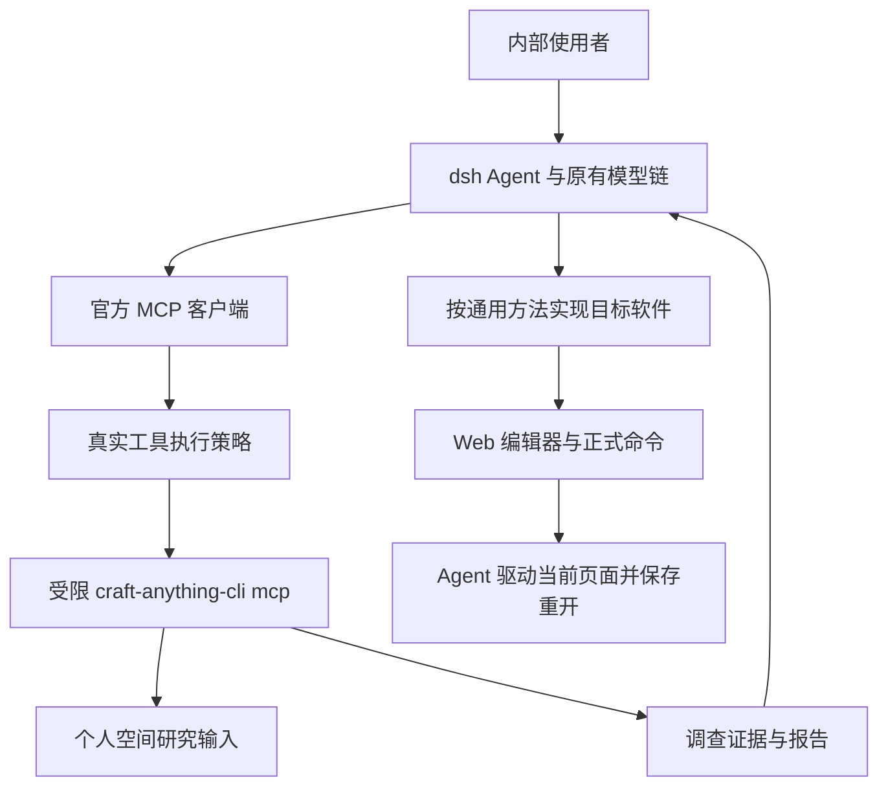

# Craft Anything 的 IntegrateCraft 接入评估

建议先把 Craft Anything 当作 dsh 可调用的受控软件分析工具，用它辅助研究和构建其他软件；由 dsh 主 Agent 继续承担模型推理与开发。独立重建循环作为后续可选能力。完整 Web 编辑产品仍需按本目录主线交付。

当前 PRD 3.2 与阶段3 D3-48 已将其归为内部软件分析与重建工具候选。本评估不新增专业编辑器条目，不调整卡 06～10 的顺序，也不放行构建、部署或付费调用。

## 1. 接入要服务什么结果

| 使用场景 | Craft Anything 的贡献 | 后续必须完成的交付 |
|---|---|---|
| 研究下一款目标软件 | 文件、程序、JS/应用图、行为线索与证据 | 功能边界、领域规则与首条用户链 |
| 评估一个开源项目能否 Craft | 结构、格式、接口线索与差异分析 | 真接口/真版本与 Web 可行性验证 |
| 生成初版 | 构建说明、代码生成、构建与部分视觉检查 | 正式领域命令、Web 编辑与接口、保存/重开 |
| 迭代已有项目 | 读取证据、对比与辅助定位 | 本次新增逻辑、必要回归和完整结果 |
| 内部报告 | 带来源、限制和未知项的分析 | 可由设计者复核的结论与具体实现依据 |

不将“重建到 Ready”直接登记为一款软件接入完成；更不能把网站视觉克隆等同于可持续编辑的软件重建。

## 2. 三条实际路径

| 路径 | 组成 | 适用性与代价 |
|---|---|---|
| A 受控分析 MCP，优先 | dsh 主 Agent→官方 MCP→分析证据，dsh 继续实现软件 | 复用统一模型、任务与大部分审计；主要补工具策略、沙箱、项目隔离和结果呈现 |
| B 内置研究/构建循环，后续 | dsh 启动 Craft Anything rebuild，内部 Agent 执行多轮 | 可复用现成编排，但需新增逐次模型上下文、任务生命周期、审批和子动作审计 |
| C 完整产品 Web 化 | 为其完整分析/重建 UI 建 Web 服务与页面 | 当前 Web 查看器不满足，涉及较大产品开发；对辅助 Craft 的目标收益较晚 |

A 能先带来分析价值，又保留本项目已有的开发和模型链。B 的价值应通过受控任务证实，再决定补接缝。C 仅在确有完整分析工作台需求时研究，不作为实现 WordCraft 式软件的前置。

## 3. 路径 A 的推荐结构

软件分析进程不调用模型时，用量来自 dsh 的正常推理，沿用既有网关。官方 MCP 运输复用 `@deepseek-ai/dsh-mcp-client`；不新写握手、JSON-RPC 或远程控制协议。

需要一个明确的研究项目上下文，而不是所有会话共享一个活动目标。首选每个活动调查有独立 `.cany` 和受控 MCP 进程/会话；若固定 MCP 客户端条目无法按调查隔离，先限制为一个显式调查会话，切换前保存关闭。具体动态会话能力要核 rc.3 扩展点后决定，不假定已有通用调度接口。

## 4. 第一期能力范围

| 能力组 | 建议处理 | 原因与前提 |
|---|---|---|
| 调查、证据、报告 | 优先研究 | 项目隔离、输出路径和数据量需受控 |
| 原生/JS 静态分析 | 选已验证子集 | 需要 Deep；输入只读，输出与限额明确 |
| 数据库、抓包和固件 | 按需求逐项增加 | 输入敏感性、格式覆盖和资源消耗分别核实 |
| 网站观察 | 独立研究后再开 | Chromium、出口代理、页面资源和目标域名要求 |
| 原生运行、设备、调试、Frida | 延后并按环境提供 | 执行目标代码、OS/设备权限与未验证项较多 |
| rebuild 与素材生成 | 第一期开关关闭 | 会触发内部模型、编译、网络或额外费用 |
| 配置、插件安装、后端 Key、setup | 普通分析 Agent 禁用 | 不能让调查材料变更平台策略或注册外部能力 |

具体允许工具从锁定注册表生成并逐项核 effects、requires、参数路径和嵌套行为。未知新增工具默认拒绝，不能靠命名或“静态”字样推断无副作用。Deep 只改变研究模式，不代表同意执行目标或任意写入。

## 5. 工具策略与平台入口

MCP 工具集只是发现机制，调用未显示工具时上游会自动启用其工具集，因此“只展示 Core”不等于能力受限。必须覆盖模型调用、直接工具执行、别名以及其他可进入原工具的路径。

现有 dsh 插件已有 `tools/execute` 与工具定义包装的应用实例，可先复用这些正式扩展点做参数和工具策略；直接执行路径能否全部经过守卫需用受控反例验证。若不能，就在可用的真实执行入口补最小策略，不能仅隐藏工具或依赖提示词。

尤其限制 `settings_set`、插件增删、模型 Key、引擎安装、`rebuild_start`、执行/设备操作和审批回答等工具。`project_inbox_answer` 可回答权限请求，不能作为普通只读状态工具放开。

`--clean-room` 能锁定该进程的模式覆盖；静态内部分析则使用经授权的 Deep 研究配置，同时继续限制工具。CLI 没有其他 Craft 的 automation roots 参数，不能复制 Word 的启动参数来获得虚假的路径保护。

## 6. 进程、路径与配置隔离

分析程序作为每用户受限子进程运行，保留现有 1 核/1 GiB/128 进程及只读根边界；大输入先测资源，超限明确拒绝或留待专用环境决定，不自动调高配额。

MCP 子进程需要与普通代码执行相当的原生沙箱。现有 FilmCraft 的 `LocalSandboxProvider`、Landlock/bwrap 启动方式可以参考，额外目录 grant 按 Craft Anything 实际写入点重新核实，不能复制 Film 配置目录。沙箱不完整应拒绝启动。

建议输入只读、证据/报告可写且位于本人个人空间。配置通过 `CRAFT_ANYTHING_CONFIG_DIR` 定位，主策略和后端配置由宿主管控；必要日志和缓存设置明确的可写目录与上限。仅改工作目录或检查顶层 `path` 不够，需覆盖归档解包、资源引用、引擎缓存、项目枚举与报告导出。

不要继承本机 Keychain、SSH agent、个人编码 Agent 配置或供应商 Key；平台分析模式不需要这些能力。受管配置失败时不能回退到默认本机自动发现。

## 7. 文件和证据呈现

`.cany` 是目录型调查项目，`craft.json` 则属于重建 workspace；在入口和文件浏览中分别识别。个人空间可以保存研究输入、报告、证据、capture 和重建项目。配置偏好不混入作品，技术目录也不承担无限量用户输入缓存。

结果通过 MCP 的 structuredContent、摘要、证据 ID 和分页返回，报告及截图走现有文件/附件展示。无需先给 Craft Anything 自建一套编辑器；如未来要做分析面板，面板只显示同一服务的状态与证据，不另启浏览器查看器冒充实时引擎。

证据内容摘要校验用于完整性，平台应另记录工具、输入摘要、项目、执行版本和任务关联。原始输入有误、工具返回空结果或部分覆盖时，报告保留对应限制。

## 8. 路径 B 的模型接缝为什么不能只改 URL

Craft Anything 可用 OpenAI-compatible Chat Completions，平台网关也有 `/v1/chat/completions`，但兼容请求格式只是第一层。当前平台在任务上下文校验启用时，消费可信调用上下文并按身份、任务和额度处理；dsh 原生模型插件还围绕每次请求 acquire/release。

Craft Anything 的内部 HTTP loop 不经过 dsh `llm/stream`，直接填 relay URL 与占位 token 不会自动完成 acquire/release。后台返回的 `task_context_required` 应保持拒绝，不能为方便接入关闭检查或给进程控制令牌。

后续若确需 B，应在现有可信来源/中继契约上补逐次桥接，做到：

1. 每个内部模型请求与本人、dsh 会话、研究项目、任务和 attempt 绑定。
2. 正常生成、上下文压缩、修正、重试、辅助问题都进入同一计量；失败和未知费用保留真实状态。
3. 供应商 Key 只留网关；请求方只用受控能力，不能自报身份或更换来源。
4. 额度用尽、停止、超时与进程退出后，不再出现脱离任务的后续模型调用。
5. 上游失败不回退本机 Key、个人订阅 Agent 或其他网络出口。

这些是未来接缝要求，当前尚未形成 Craft Anything 的实现或验证。已有 05 能力和当前模型任务链只复用其契约，不借用旧测试账本、密钥授权、次数或运行环境。

## 9. 路径 B 的任务与审批接缝

`rebuild_start` 在 MCP 进程内维护后台运行/排队，默认并发 2；dsh 外层工具返回不代表后台完成。需要让后台运行与平台任务存活期一致，先按资源核定并发，避免形成无人管理的嵌套 Agent。

自然语言任务要由平台发起、可见进度、可停止。停止应调用对应 run 的停止并终止所属子进程树，保存中间工程、结算已发生用量，收回临时上下文；实例销毁或客户端断线的策略单独定义。不能仅关闭对话工具结果就认为内部工作停止。

普通 MCP 启动没有桌面 inbox 审批卡。可利用其持久问题/inbox 契约映射到现有 dsh 审批，但需核请求身份、防重复、防过期和拒绝传播。不上 `--allow-run` 来一次性免掉所有内部授权。由同一 Agent 自动回答自身审批也不构成人工授权。

## 10. 网络、构建与预览缺口

分析静态文件可先不联网。网站观察依赖浏览器、目标及资源域名、重定向、CDP 和图片产物。Chromium 是否能在现行沙箱运行、所有请求是否强制经过出口策略，都需要实测；不能用开发机浏览器的成功替代容器结果。

重建还可能执行 npm/cargo、下载依赖、生成素材并运行新程序。默认镜像未把 Rust/Java/Go 作为通用学生工具；某些 Craft CLI 已预编译并不代表具备其源码构建环境。构建工具与依赖缓存宜锁定并预置，额外环境由后续范围决定。

上游本地 preview 监听回环端口，无法直接在远程用户浏览器访问。现有严格 CSP 文件查看也不能替代交互网站运行。若需要真实预览，必须将指定任务的产物/服务映射到经认证的隔离预览源，并处理端口归属、超时、WebSocket 和销毁；当前没有证据说明这些已为 Craft Anything 提供。

完整生成网站预览不进入工作台同源静态软件目录。生成出的编辑器源码若要作为可信软件上线，须完成审查、锁定构建和正式接入。

## 11. 审计与最终验收

路径 A 的顶层分析工具可复用 dsh 执行轨迹，但外部进程内部行为仍按需要补来源记录。路径 B 的子工具、子命令、文件变更、授权和模型请求需要逐步上报实例外追加存储；项目内 journal 可由执行主体改写，只作为业务材料。

验收将结果分为“已有可运行产物”“质量达到目标”“平台链通过”。消费具体 checks、claims、unknowns 和相似度，另加领域结果。软件最终还要证明 Agent 正式命令操作当前 Web 页面、手改可读、个人空间保存、导出及关页续作。

## 12. 补齐优先级与可独立核验的结果

| 顺序 | 工程结果 | 主要补齐 | 通过证据 |
|---|---|---|---|
| 0 | 锁定版本和接口事实 | Linux CLI、依赖、schema、配置/路径/退出与资源核实 | 零费受控探针，不安装到生产 |
| 1 | 一条受控静态分析用户链 | 官方 MCP、工具策略、沙箱、独立 `.cany`、证据呈现 | 真工具→真输入→报告重开，越界反例拒绝 |
| 2 | 辅助 Craft 一款软件 | 研究材料进入方案，dsh 完成实现 | 按主线完成 Web/Agent/保存用户结果 |
| 3 | 可选内部重建循环 | 逐次模型上下文、费用、生命周期、审批和审计 | 全辅助调用可对账，停止后无孤儿，独立结果成立 |
| 4 | 可选分析工作台/目标扩展 | 面板、网站/设备/运行工具及专用环境 | 按新增范围分别补证 |

这是评估顺序，不是已发卡计划。无必要时停在路径 A；是否启动每一步由后续用户目标和正式卡决定。

## 13. 最小验证清单

零模型先覆盖工具允许/拒绝、参数和嵌套路径、项目隔离、沙箱不完整拒启、只读模式、真实报告与大结果分页、进程取消和崩溃清理。网站路径再核代理、重定向与资源来源；重建路径再核多轮模型、费用、inbox 和预览。

新增适配与守卫有单测，真实完整链验业务结果；既有回归按实际影响选择，其他完整关口留到最终。原模型 Key 授权、预算与当前任务资源均不因本报告延伸到新接入。

本地来源和未验证范围见 [依据与差异登记](依据与差异登记.md)。
