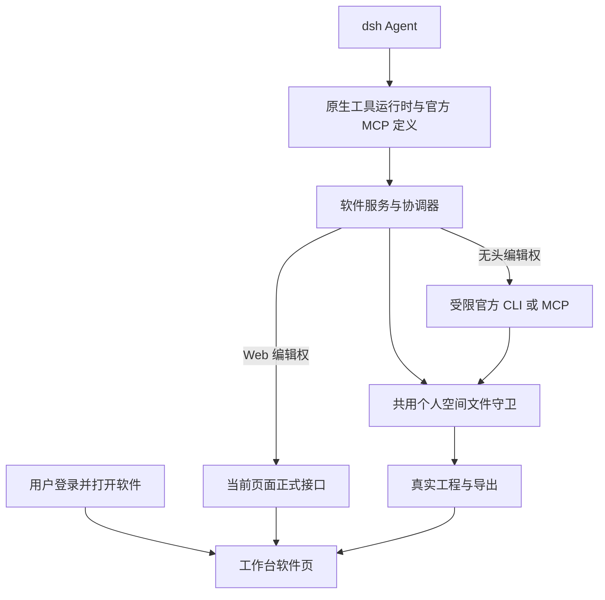

# IntegrateCraft 接入与复用边界

目标软件应通过现有工作台获得 Web 入口、Agent 工具、个人空间和平台治理。默认沿用 WordCraft 最终方法及已合并的共用实现，只补锁定版本上真实存在的差异。本文面向以后 Craft 出来的各类软件，不改变当前软件范围或开工顺序。

权威依据：[技术方案 9.6](../../技术方案.md#96-软件工作台与-agent-操作软件)、[软件接入方法](../../任务卡/阶段3-原型完善/软件接入方法-以WordCraft为基线.md)、[当前阶段入口](../../任务卡/阶段3-原型完善/README.md)。

## 1. 当前平台已有的能力

| 现有能力 | 实现入口 | 下一款如何复用 |
|---|---|---|
| 每用户执行实例 | `apps/orchestrator/src/runtime.ts`、`docker.ts` | 在本人隔离实例运行已锁定 CLI，保留现有资源边界 |
| 统一模型与额度 | `apps/gateway`、runtime 模型插件、可信 relay | dsh 使用统一模型；软件优先作为工具 |
| 软件静态托管 | `apps/platform/src/software.ts` | 注册锁定 Web 包，核实际字节与缓存身份 |
| 工作台布局和文件入口 | `catalog.mjs`、`client.jsx` | 接入软件元数据、可识别格式和三种视图 |
| 官方 MCP 运输 | 固定 rc.3 MCP 客户端及 profile 条目 | 复用工具发现和执行，不手写 JSON-RPC |
| 页面工具往返 | `service.mjs`、`channel.mjs` | 复用认证路由、claim/poll/reply 和超时 |
| 工程协调 | 共用 coordinator 及各款适配 | 编辑权、串行操作和交接按本款语义接入 |
| 文件与保存守卫 | `SpaceFiles`、`SoftwareFiles` | 复用路径保护、中文命名、外改和确认 |
| 只读查看与审计 | viewer policy、trace reporter、平台 trace | 新入口接入现成拒写和执行轨迹链 |
| 构建锁定 | `craft/<software>/`、用户镜像构建 | 固定源码、补丁、依赖、制品和运行指纹 |

目录中部分 CAD 路径在本轮开始时已有未提交施工改动。这里把它们视为在途工作，不据此登记接入通过；复用基线在发卡时重新锁定。

## 2. 新软件进入平台的最短完整链

已有 Web 页面接口直接使用；只有原控制通道时补薄接口。没有可用编辑页面的项目先解决 Web 产品能力，不能把轻量查看器登记为已具备实时编辑。

## 3. 接入时通常涉及哪些位置

以下是影响范围地图，具体改哪些文件由该款研究结果和届时任务卡确定。

| 位置 | 需要核实或补充什么 |
|---|---|
| `craft/<software>/README.md`、锁文件、构建与补丁 | 固定版本、官方接口、字体/i18n、Web/CLI 产物和许可材料 |
| `images/user-instance/` 构建入口 | Linux 目标二进制、必要依赖、运行配置与制品校验 |
| `dsh/bundle/cordis.patch.yml` | 官方 MCP 条目、真实支持参数、配置目录和启用条件 |
| `catalog.mjs` | 软件 ID、Web 路径、原生格式及工具差异，避免抢占其他格式 |
| 本款 page/tools 接缝 | 同一页面实例、原 schema、真实内容与文件结果 |
| 共用 service/coordinator 接线 | 页与无头的路由、保存和异常恢复，避免另造完整框架 |
| 平台 software 路由与软件登记 | 后台可用状态、静态资源、版本身份和授权开关 |
| 本款测试与必要共用回归 | 新增逻辑、真实往返、保存重开及受影响能力 |

业务结果按一款软件完整用户链组织，不机械地按上述文件拆成多张碎片卡。

## 4. 页面驱动的最小差异

本款适配要回答：如何查询命令、如何操作当前对象、是否原生 batch、怎样检查内容与渲染、如何确认真正打开、怎样拿到保存字节、如何确认宿主已写入。方法名、参数、错误和完成时刻来自真实接口。

统一别名可改善使用体验，但别名保留官方定义。当前页面正在持有工程时，工具必须经页面接缝执行。关闭页面或切换编辑权时，按现行协调器契约保存并让接手方读取同一实际文件。

不默认复制 Light 的照片库锁、Fig 的专用保存票据，也不按旧资料重建 H2 事件服务。通用语义通过现有队列、文件守卫和原生接口表达。

## 5. 个人空间与只读边界

个人空间挂载 `/data/spaces`，dsh 技术数据挂 `/data/dsh`。作品、导出、导入素材和工程资源以个人空间为准；偏好及必要软件配置按现有模式放技术目录。新增大量缓存的归属和上限单独说明，不能借技术目录绕过空间限额。

官方 CLI 有读写根参数才传真实参数；没有时使用经验证的原生沙箱、挂载和路径保护。MCP 子进程不能因运行在本人容器就默认拥有读取平台令牌和全部技术数据的权限。FilmCraft 的受限启动实现提供了现成参考，所需额外目录按本款重新核实。

管理员只读查看要在服务端拒绝所有变更入口，包括工具、文件保存、工程创建、授权回答和启动子任务。不能只隐藏按钮。

## 6. 模型、费用与审计

默认结构由 dsh 主 Agent 调软件工具，模型请求继续走平台统一网关。不要给每款软件添加供应商 Key、个人订阅登录或独立计费后台。

若软件自身必须发模型请求，需补原生请求与平台任务上下文的受控接线。网关启用上下文校验时要求可信一次性调用上下文；配置兼容 URL 不会自动完成任务登记、逐次计量和轨迹对应。供应商真实 Key 仍只在网关受管存储。

软件生成的业务证据可放作品空间；平台执行审计仍走实例外追加链。内嵌后台 Agent 的多步操作需要逐步关联，单条“启动重建”记录不能替代内部动作记录。

## 7. 网络与预览

实例外网默认禁止，只能经出口代理访问管理员放行的 HTTPS 域名；模型域名不能通过放行绕过网关。字体、依赖和内置资源尽量随已锁定包交付；运行时下载需要按现有规则核实。

经审核的编辑器 UI 沿用工作台同源宿主接口。用户生成的 HTML/JS 属不可信内容：现有用户文件响应有严格 CSP，完整交互预览还需使用平台规定的隔离来源。现有文件预览并不自动提供任意本地 dev server 的安全反向代理；需要这类能力时另行核实。

## 8. 资源与运行环境

当前实例约束包括 1 核、1 GiB、128 进程和只读根文件系统；`/tmp` 为有上限的 noexec 临时盘。域内原生软件和浏览器 WASM 的资源位置不同：页面引擎主要消耗客户端资源，无头分析/编译消耗用户实例资源。

新软件若需要 Rust/Java/Go、Chromium、Ghidra、GPU、音视频工具链或较大缓存，逐项测量。不要将开发机已安装工具当作默认镜像已有能力，也不为研究自动上调实例资源。

## 9. 未来接入关口

| 关口 | 必须回答的问题 |
|---|---|
| 接口核实 | 版本、页面、CLI、文件桥、中文、限制有一手依据吗 |
| 最小完整链 | Agent 能改到当前页面，用户能手改并被工具读到吗 |
| 作品交付 | 保存确认、导出、冲突和关页重开核到真实内容了吗 |
| 治理接缝 | 空间、只读、模型、网络、取消与审计覆盖新增入口吗 |
| 运行一致 | 锁、源码、bundle、镜像和实际加载对应吗 |
| 正式验收 | 本卡新增/关联测试与真实链完成，最终关口仍保留吗 |

未满足项先形成有边界的研究或设计差异，交发卡方评估。本文不新增软件目录项、不更改当前卡、不启动服务或真实模型。
