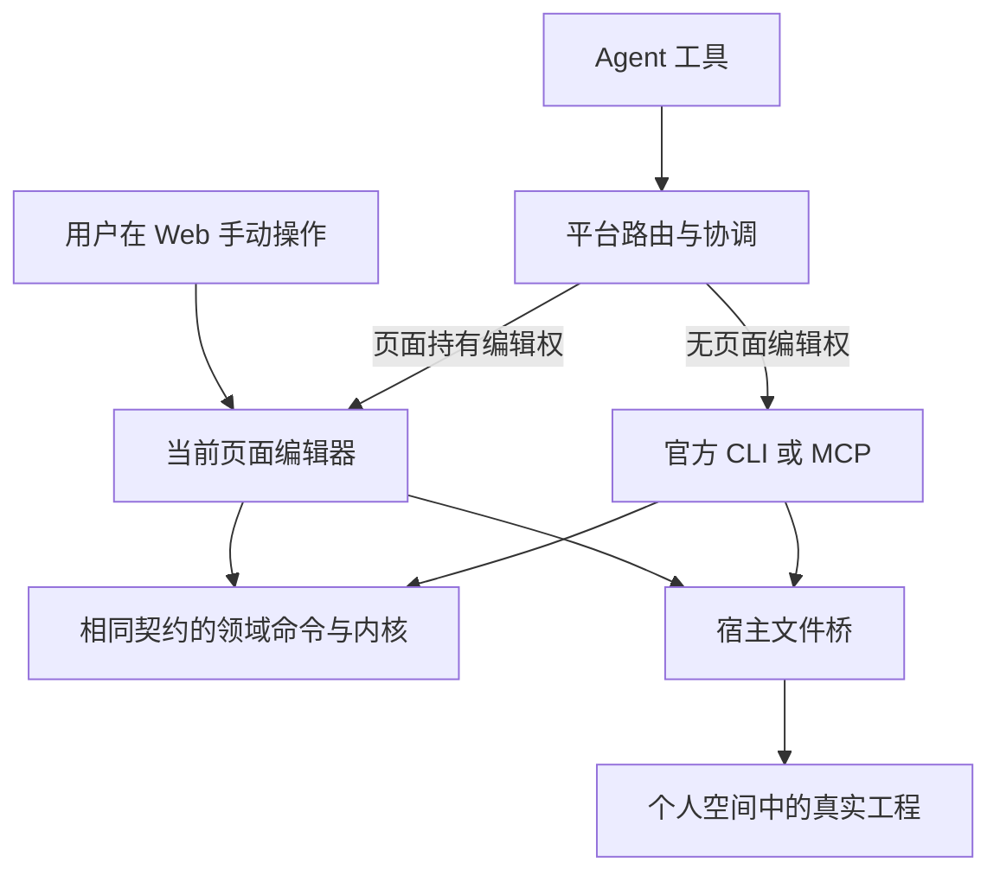

# 命令内核与多端架构

领域操作由一个内核负责，用户界面与 Agent 都通过正式命令改变同一状态。CLI/MCP 提供无界面入口，Web 页面接口负责到达当前页面引擎；业务逻辑不分别写在这些入口中。

## 1. 建议的职责分层

图中的“相同内核”指同一套业务实现与命令语义。浏览器与原生进程各有运行实例；平台必须协调同一作品的编辑权，不能假定两个实例会自动共享内存状态。

| 层 | 负责 | 避免放入 |
|---|---|---|
| 领域内核 | 文档/场景、规则、计算、撤销、序列化 | 平台账号、模型 Key、网页路由 |
| 命令层 | schema、前置条件、业务执行、结构化结果 | UI 弹窗、自由文本判定 |
| Web 适配 | 页面实例调用、异步回执、内存文件桥 | 第二套编辑规则 |
| CLI/MCP | 工具发现、原生运行、权限契约 | 平台管理入口 |
| 宿主平台 | 身份、工具路由、空间、治理与视图 | 新的格式转换引擎 |

Rust+WASM 适合已有可移植内核的项目；原生 Web 项目也可用 TypeScript 或其他适合领域的实现。选择依据是现有资产、性能、依赖和部署条件。

## 2. 每个命令应明确的契约

命令至少有稳定 ID、用途、参数 schema、目标文档/对象、前置状态、副作用、返回结果和错误。需要时补取消、进度、分页、批处理语义与可重试条件。

例如“设置对象位置”需要对象身份、坐标系、单位和变换语义；“保存”需要工程身份、保存快照与确认边界。参数不能只写一个难以验证的自由 JSON。

工具调用的可观测结果应区分：

- 命令已接收，尚在排队。
- 内核已完成，状态修订已变化。
- 渲染已完成，可以读取当前画面。
- 宿主文件已写入成功，可以报告已保存。

四个时刻可由现有协议字段表达，不要求每款新增四套票据。适配器只解释真实契约，避免把“入队成功”包装成“打开完成”。

## 3. 人与 Agent 的能力对应

用户可完成的核心业务操作，应存在可查询、可执行、可检查的程序入口；程序入口执行的状态应能被 UI 正确展示。纯视图命令与领域编辑命令分别登记，不能把“所有命令数”当作业务功能完成度。

命令清单由注册表生成。测试重点是新命令的业务效果、边界和 UI 可达性；已有能力沿用现成测试，不为每次平台接入重补整套。

## 4. 持久身份和状态协调

分别识别工程、文档、对象、页面实例与当前修订。名称可变，不能用标题代替身份。对同一工程的修改、保存与交接在一个协调顺序中执行；不要在既有串行队列中再次等待它自身。

页面销毁或换工程后，旧命令回执和保存确认不能作用到新工程。具体实现可用原生文档 ID、修订、页面 generation 或已有票据组合；按本款缺口补足，不把 FigCraft 的专用协议推广为统一必需项。

## 5. 批处理、撤销与大任务

有原生原子 batch 时保留其契约，不能在 JS 中逐条调用后声称原子成功。区分全体回滚、遇错停止、部分成功继续；结果应逐项说明已执行范围。

撤销边界与用户心智一致：一条复杂操作是否作为一个事务、Agent 的一组操作能否整体撤销，需要由本款领域决定。运行时失败不应留下无法解释的半成品。

长任务提供进度、取消与资源清理。重试前判断操作是否有副作用；断线后先查询实际状态，不能直接重复导入、导出或付费调用。

## 6. 对现有项目的最小改造

优先顺序是：已有命令直接复用 → 已有控制通道补薄页面接口 → 缺领域能力时实现本款内核。WordCraft 已通过补丁把现有 `ControlRequest` 接到浏览器 Promise 接口，保留桌面协议和编辑器内核，见 [WordCraft 构建与接口](../../../craft/wordcraft/README.md)。

Craft Anything 的统一 `ToolSpec` 和证据模型可作为设计参考，但它的分析工具输出并不自动成为编辑器命令，更没有替下一款软件提供领域内核。
