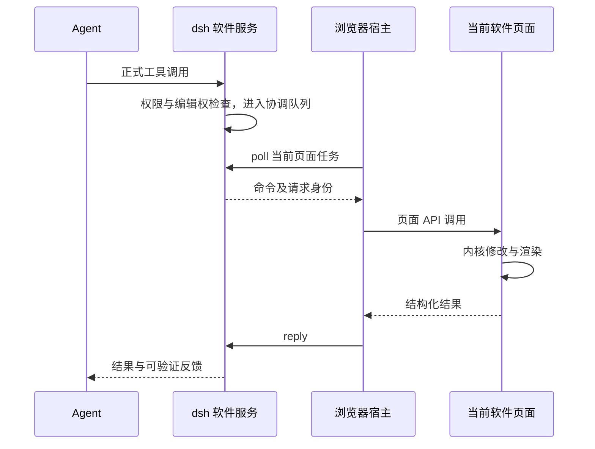

# Web 化与 Agent 实时交互

实时交互的关键是让 Agent 的修改到达用户正在观看的那个页面引擎。把静态页面嵌入工作台、运行另一个 MCP 进程、展示一张截图，各自都不能独立证明这件事。

## 1. 先判断页面是哪一种

| 页面形态 | 能做什么 | 还需补什么 |
|---|---|---|
| 已有 Web 编辑器和页面命令接口 | 可复用当前页面引擎 | 平台工具路由、空间与保存接缝 |
| 有完整 Web 编辑器，无程序入口 | 人可编辑 | 原控制器的薄异步页面接口 |
| 只有桌面编辑器 | 具备原生业务能力 | 内核可移植性、浏览器依赖、渲染和文件边界 |
| 只有 Web 查看器 | 识别或显示文件 | 编辑内核、命令、交互及工程写回 |

Craft Anything 当前属于最后一类轻量查看器，不能拿它的 Web 构建证明完整重建产品可直接嵌入。

## 2. 页面接口需要提供的能力

以下是能力要求，方法名按各款实际协议确定：查询命令与参数、执行命令、检查当前内容、渲染当前结果、载入文件、取出保存/导出数据、读取 dirty 与修订、接受宿主保存结果。

对已有接口直接适配；缺接口时让薄 Promise 接口转交已有控制器。不要通过模拟鼠标键盘承担正式软件操作，也不从 DOM 文案推断领域状态。

WordCraft 的真实接口包括 `request/execute/commands/inspect/screenshot/render`。其 `openFile` 表示文件入队，平台加载逻辑还需等待实际文档状态；直接 `await openFile()` 不能证明内容已打开。

## 3. 复用现有平台往返

当前 IntegrateCraft 的 `PageChannel` 通过认证的 `/api/software` Fetch 路由维护页面 claim、队列、poll、reply 与 release；客户端当前按 100ms 定时轮询。它已承担请求配对、超时与断开处理，见 [channel](../../../dsh/plugins/software/channel.mjs) 和 [客户端](../../../dsh/plugins/software/client.jsx)。

旧资料提出的新事件通道是早期设想。本轮方法沿用现成运输，不因重整文档要求替换为 WebSocket 或新 RPC。将来若测得轮询影响目标体验，再单独评估运输优化。

## 4. “实时可见”的验收口径

先用真实工具做一次确定性的修改，例如插入指定中文、移动已知对象或设置轨道参数。独立读取页面领域状态，再取得实际渲染；随后用户在页面手改，Agent 的下一次检查必须读到手改结果。

记录工具开始、内核完成、画面更新的时间；在目标设备上测量用户可接受程度。复杂渲染可以渐进展示，但不能先回复最终完成，页面还留在旧状态而没有说明。

等待截图时使用本款真实的渲染/素材就绪信号，任意延时只能作诊断。后台标签页、折叠面板、窗口缩放、DPR、GPU 丢失和浏览器节流要按实际影响验证。

## 5. 三种视图与编辑权分开管理

Agent、Agent+WebGUI、WebGUI 是布局和交互入口。页面是否仍加载、是否持有编辑权，以现行协调器实际状态为准，不能通过“当前看不见”推断引擎已销毁。

切换需要交接时，必须先把修改保存到真实文件，确认成功后由接手引擎读取。失败保留原编辑来源和未保存内容。页面正在持有当前作品的可视编辑权时，Agent 修改必须到该页面；不能静默另起无头副本。

WordCraft 当前 `changeMode('agent')` 有保存并交给 MCP 的实现；旧文的“切视图始终不换引擎”不能作为所有版本的事实。后续复用要核锁定版本及当前卡契约，不据本文重开已接受成果。

## 6. 浏览器资源与宿主边界

Web 可用性还包括中文 UI 与文档字体、输入法、剪贴板、GPU/音视频依赖和资源释放。字体翻译分别验证；DOM 有中文字不代表画布能画出字形。

可信软件编辑器可按现行同源宿主模式运行，文件桥检查来源窗口、origin 和请求身份。用户生成的网站代码按平台预览隔离规则使用不同源；不能为了方便调用页面 API，让生成的任意脚本进入工作台源。

浏览器不保留作品恢复副本；原生支持内存/宿主模式就复用，缺少时只补作品持久化接缝。页面命令和文件桥的生命周期须在卸载时清理，旧回执不得复活旧页面。
