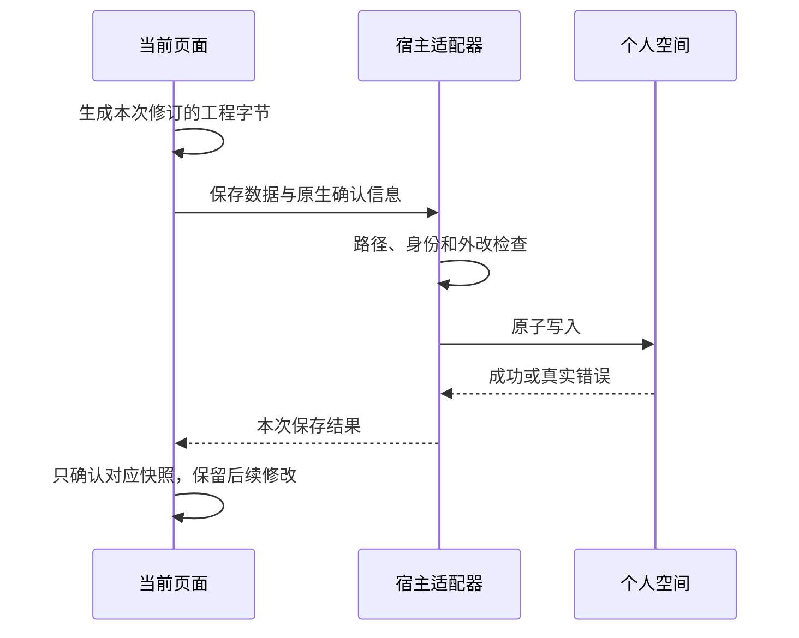

# 工程文件与保存恢复

作品以个人空间中的真实工程为准。页面内存是当前编辑状态，导出是可交付副本；两者通过本款文件桥关联。宿主写入成功之前，不能显示已保存或向 Agent 声称文件已完成。

## 1. 先区分四种文件身份

| 身份 | 含义 | 要避免的混淆 |
|---|---|---|
| 导入源 | 作为输入读取的原材料 | 打开图片后自动拿图片路径当工程保存目标 |
| 当前工程 | 可持续编辑的工作文件/目录 | 把预览、截图字节写回工程 |
| 另存目标 | 一个新的工程身份 | 保存失败却提前切换当前路径 |
| 导出副本 | PNG、PDF、音频等交付结果 | 导出后把副本当当前工程 |

名称、后缀和标题都不足以唯一确定身份。页面文档 ID、宿主路径和当前快照应明确绑定。

## 2. 保存完整往返

WordCraft 已利用原生 AsyncSaves 与宿主确认补丁实现该链。下一款优先复用原生能力，确有缺口才补薄接缝，不新增编辑命令或格式模型。

确认必须对应保存时的文档和快照：保存期间又产生编辑，旧成功不能清除新 dirty；切换文档后的迟到确认不能误清另一份工程。

## 3. 外改冲突与空间写入

复用 `SoftwareFiles` 的打开/上次确认字节基线与 `SpaceFiles` 的安全 I/O。保存前核当前文件是否仍等于观察基线；外改则停止覆盖，提供有效的重新载入和另存副本入口。新文件命名复用现有中文命名与同名避让规则。

普通文件冲突不等同于完整目录工程冲突。照片库、媒体目录和多文件工程需要根据实际事务边界核实，不能要求所有目录摘要永远不变，也不能只核主文件就认为外部资源完整。

存储层配额是最后的强制边界，任何入口写入都应受同一配额。空间满、权限拒绝、网络断开、原子写入失败均要反馈到页面；失败后保留可继续保存的编辑内容。

## 4. 关闭、切换与重开

自动保存、手动保存、工具保存、关闭前保存使用同一真实确认逻辑。自动保存周期沿项目现行契约；目录型持续写回按该款语义处理。保存与导出落个人空间，不自动下载。

重开验证必须销毁旧页面实例，重新读取真实文件，再做一次新编辑并保存。只在旧页面刷新状态，无法证明加载了磁盘产物。页面与 CLI 交接时消费同一路径的实际写入，不用测试脚本补写一个相似文件。

## 5. 多文件工程的资源策略

明确哪些资源嵌入工程、哪些相对引用、哪些只读链接；迁移或另存时应怎样重定位。可交付工程需要有完整资源清单，缺失项显示具体原因。路径校验覆盖嵌套引用和归档解包，不能只检查顶层参数。

大资源传输优先复用已有流式/文件通道；内存文件桥适合的大小以真实限制为准。构建缓存、临时导出和日志的空间归属要登记，防止作品绕进不计个人空间的技术目录。

## 6. 浏览器持久化与导出

按本项目规则，浏览器可保留偏好，不保留作品恢复副本。核正常保存、崩溃恢复、IndexedDB、OPFS、service worker 与资源缓存中的实际内容；退出时清站点存储只能兜底，不能替代运行期间的保证。

导出验收检查格式、内容、尺寸/时间/页码等领域结果，并确认路径与当前工程不同。文件存在、大小非零或 HTTP 200 都不能替代这些断言。

## 7. 最少需要覆盖的异常

同路径外改、同名另存、保存后继续编辑、保存期间切稿、空间满、写入失败、断线、关闭失败、缺失资源、非法引用。已有守卫测试复用；本款新增协议与适配补相应单测，再做真实链验证。

相关代码：[安全文件与协调](../../../dsh/plugins/software/coordinator.mjs)、[保存冲突](../../../dsh/plugins/software/software-files.mjs)、[Word 页面文件桥](../../../dsh/plugins/software/word-page.mjs)。
